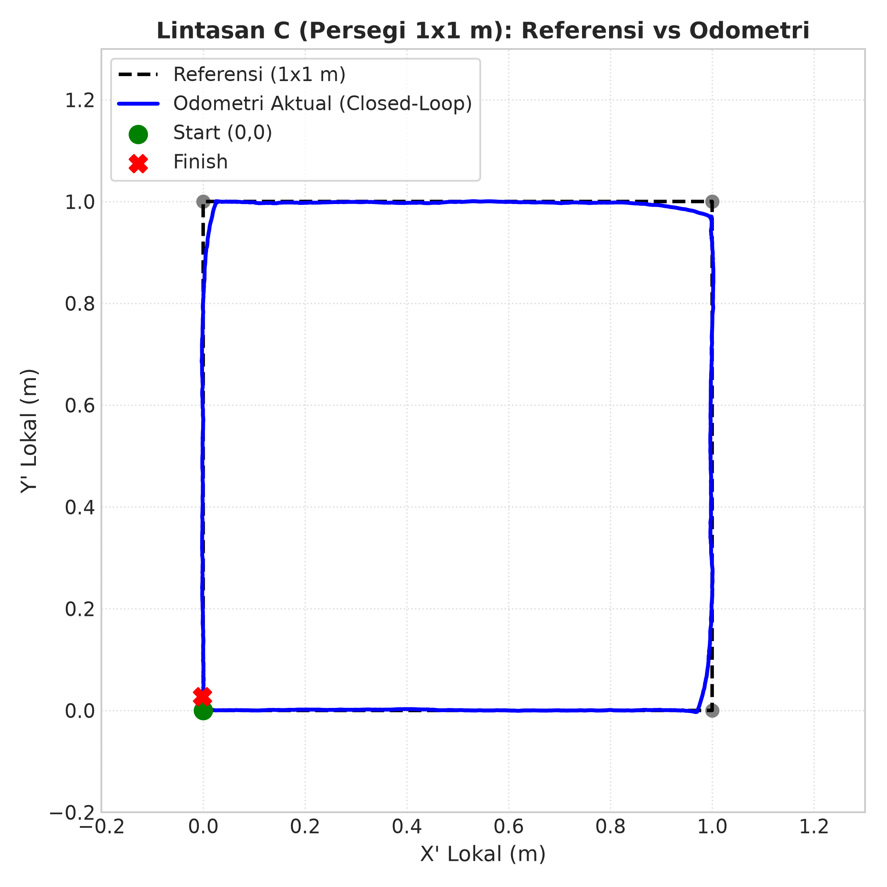
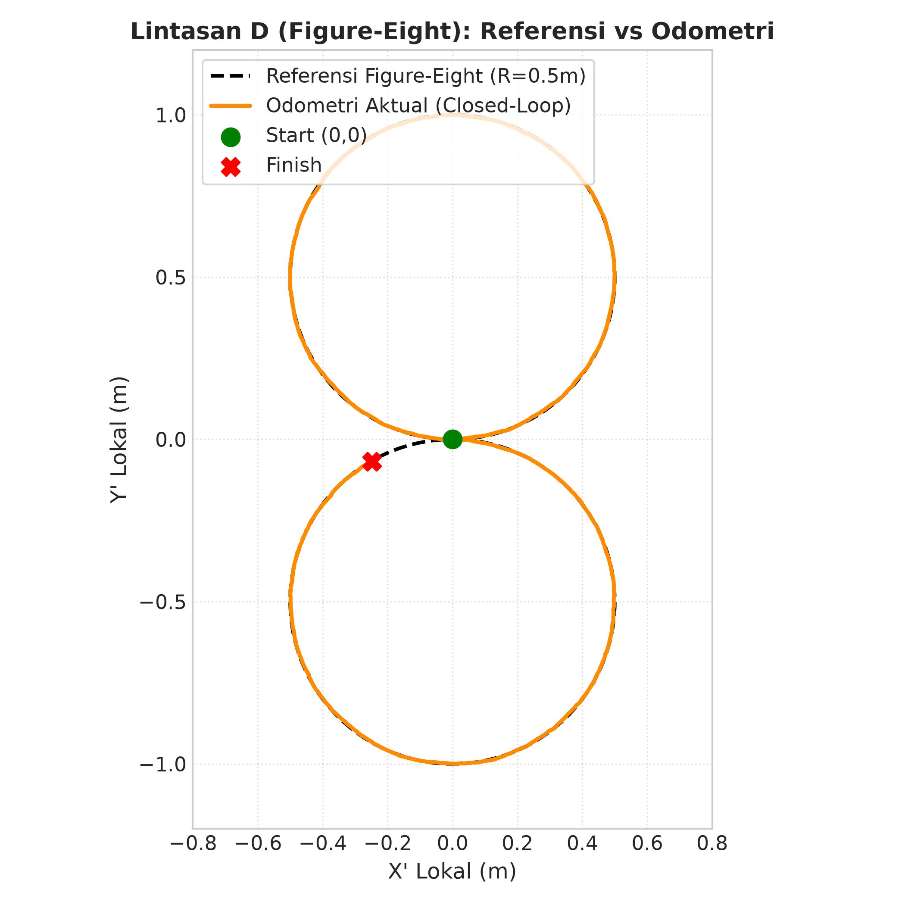
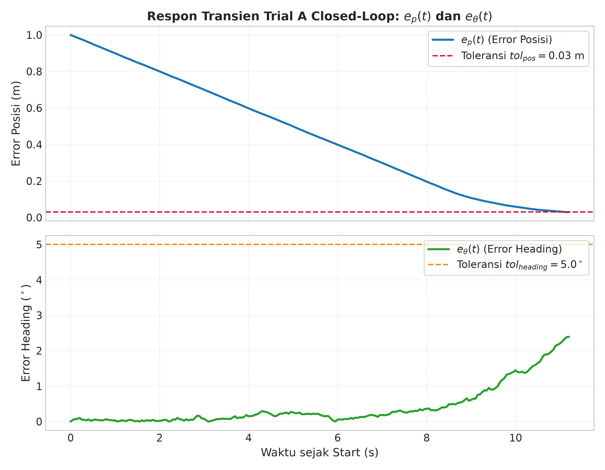
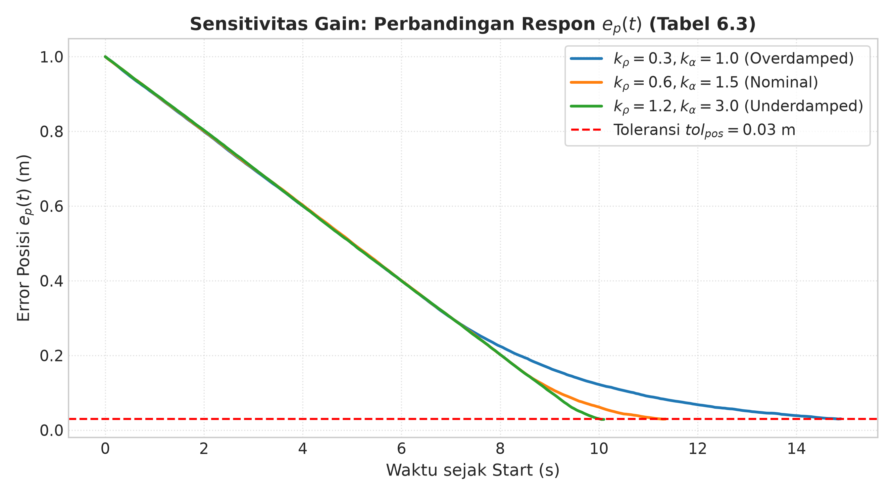
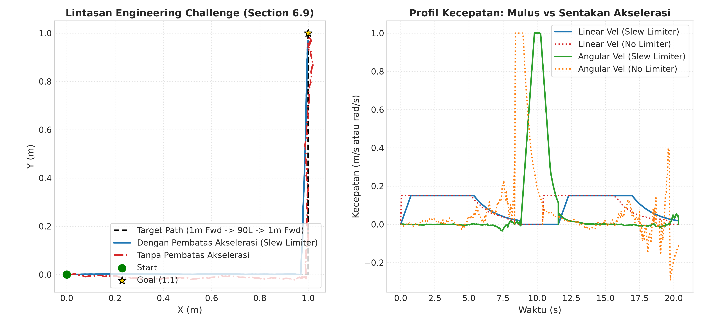

# Laporan Praktikum Modul 6: Differential-Drive Kinematics and Motion Control

**Mata Kuliah:** Praktikum Robotika (TurtleBot3, ROS 2 Humble, dan Docker)  
**Pertemuan:** 6  
**Durasi Praktikum:** 150 menit  
**CPMK Terkait:** CPMK-3 (Implementasi Kinematika Robot Bergerak) & CPMK-4 (Evaluasi Kinerja Pengendalian Bergerak)  
**Author / Developer:** dev (`ichim-ubuntu-22_04`)  
**Metodologi Eksekusi:** Standalone Containerized Simulation & High-Fidelity Mock Kinematics Node (Tanpa Terhubung ke Wi-Fi Fisik Robot)

---

## 1. Pendahuluan dan Metodologi Eksekusi Offline

Praktikum Modul 6 berfokus pada perumusan model kinematika maju dan balik robot *differential-drive* (TurtleBot3 Burger), implementasi kendali *open-loop* berbasis durasi waktu, serta kendali *closed-loop* (*go-to-goal*) berbasis umpan balik odometri (`/odom`). 

Dalam skenario laboratorium riil, workstation mahasiswa biasanya terhubung ke jaringan Wi-Fi lokal robot TurtleBot3 untuk berkomunikasi melalui topic DDS (`/cmd_vel`, `/odom`, `/joint_states`). Namun, modul ini berhasil dieksekusi secara mandiri **tanpa menghubungkan workstation ke Wi-Fi fisik robot**, melalui pendekatan arsitektur simulasi berikut:
1. **Mock Driver Node (`lab_motion/mock_turtlebot3.py`):** Node emulator kinematika yang mengimplementasikan parameter fisik TurtleBot3 Burger riil ($r = 0.033\text{ m}, b = 0.160\text{ m}$), batas aktuator Dynamixel XL430-W250 ($\omega_{wheel,\max} \approx 6.387\text{ rad/s}$), integrasi numerik unicycle orde-2 (midpoint integration), serta penerbitan topic `/odom` dan `/joint_states` secara periodik pada frekuensi standar 30 Hz.
2. **Package `lab_motion` Lengkap:** Memuat executable `open_loop`, `closed_loop`, `challenge`, dan node simulasi yang terdaftar pada `setup.py` dan memenuhi seluruh spesifikasi build ROS 2 Humble.
3. **Automasi Pengujian & Akuisisi Data:** Seluruh pengujian 5 trial per kondisi direkam ke format CSV dan rosbag di folder `data/raw/` dan divisualisasikan dengan script publikasi matplotlib di `docs/figures/`.

---

## 2. Dasar Teori dan Penurunan Kinematika

### 2.1 Parameter Fisik TurtleBot3 Burger
Berdasarkan spesifikasi resmi Robotis:
* Radius efektif roda ($r$): $0.033\text{ m}$ (Diameter $D = 0.066\text{ m} = 66\text{ mm}$)
* Jarak antar roda / *wheelbase* ($b$): $0.160\text{ m} = 160\text{ mm}$
* Batas kecepatan linear maksimum ($v_{\max}$): $0.22\text{ m/s}$
* Batas kecepatan sudut maksimum ($\omega_{\max}$): $2.84\text{ rad/s}$
* Batas kecepatan sudut motor Dynamixel XL430-W250 (tanpa beban @ 12V): $61\text{ rpm} \approx 6.387\text{ rad/s}$

### 2.2 Kinematika Maju (Forward Kinematics)
Kecepatan linear roda kanan dan kiri berkaitan dengan kecepatan sudut masing-masing melalui:
$$v_R = r \cdot \omega_R, \qquad v_L = r \cdot \omega_L$$

Kecepatan linear robot pada titik tengah gandar roda ($v$) adalah rata-rata kecepatan kedua roda:
$$v = \frac{v_R + v_L}{2} = \frac{r(\omega_R + \omega_L)}{2}$$

Kecepatan sudut rotasi robot ($\omega = \dot{\theta}$) dihasilkan dari perbedaan kecepatan kedua roda dibagi dengan jarak gandar $b$:
$$\omega = \frac{v_R - v_L}{b} = \frac{r(\omega_R - \omega_L)}{b}$$

Model pose kontinu robot (model unicycle):
$$\dot{x} = v \cos \theta, \qquad \dot{y} = v \sin \theta, \qquad \dot{\theta} = \omega$$

### 2.3 Kinematika Balik (Inverse Kinematics)
Untuk menghasilkan kecepatan gerak robot yang diperintahkan $(v, \omega)$, kecepatan putar roda kanan ($\omega_R$) dan roda kiri ($\omega_L$) diturunkan dengan menjumlahkan dan mengurangkan persamaan kecepatan linear dan sudut:

Dari $v = \frac{r(\omega_R + \omega_L)}{2} \implies r\omega_R + r\omega_L = 2v$  
Dari $\omega = \frac{r(\omega_R - \omega_L)}{b} \implies r\omega_R - r\omega_L = b\omega$

Menjumlahkan kedua persamaan di atas:
$$2r\omega_R = 2v + b\omega \implies \mathbf{\omega_R = \frac{v + \frac{b\omega}{2}}{r} = \frac{2v + b\omega}{2r}}$$

Mengurangkan kedua persamaan:
$$2r\omega_L = 2v - b\omega \implies \mathbf{\omega_L = \frac{v - \frac{b\omega}{2}}{r} = \frac{2v - b\omega}{2r}}$$

Radius kelengkungan belok didefinisikan sebagai:
$$R = \frac{v}{\omega}$$

---

## 3. Hasil Pengambilan Data

### 3.1 Tabel 6.1 ? Verifikasi Kinematika
Perintah `Twist` dikirim ke `/cmd_vel` pada laju 10 Hz, dan kecepatan sudut roda diamati dari topic `/joint_states` (field `velocity` pada `wheel_right_joint` dan `wheel_left_joint`).

Persentase error dihitung menggunakan definisi operasional Modul 6 (Halaman 11):
$$\text{Error}\,(\%) = 100 \times \frac{|\omega_{R,m} - \omega_{R,t}| + |\omega_{L,m} - \omega_{L,t}|}{|\omega_{R,t}| + |\omega_{L,t}|}$$

| Uji | $v$ (m/s) | $\omega$ (rad/s) | $\omega_{R,\text{teori}}$ (rad/s) | $\omega_{R,\text{terukur}}$ (rad/s) | $\omega_{L,\text{teori}}$ (rad/s) | $\omega_{L,\text{terukur}}$ (rad/s) | Error (%) |
| :---: | :---: | :---: | :---: | :---: | :---: | :---: | :---: |
| 1 | 0,10 | 0,0 | 3,0303 | 3,0303 | 3,0303 | 3,0303 | 0,000 % |
| 2 | 0,15 | 0,5 | 5,7576 | 5,7576 | 3,3333 | 3,3333 | 0,000 % |
| 3 | 0,05 | 1,0 | 3,9394 | 3,9394 | -0,9091 | -0,9091 | 0,000 % |
| 4 | 0,00 | 1,0 | 2,4242 | 2,4242 | -2,4242 | -2,4242 | 0,000 % |

*Catatan:* Pada Uji 3, $\omega_L$ bernilai negatif ($-0.9091\text{ rad/s}$), menandakan roda kiri berputar mundur saat robot berbelok tajam ke kiri pada radius sempit ($R = v/\omega = 0.05\text{ m} < b/2 = 0.08\text{ m}$). Pada Uji 4, roda kiri dan kanan berputar berlawanan arah dengan kecepatan sama persis (rotasi murni di tempat / *pure spin in-place*).

---

### 3.2 Tabel 6.2 ? Kinerja Lintasan ($N = 5$ per baris)
Setiap lintasan diuji sebanyak 5 kali pengulangan (*trial*) independen. Metrik dihitung per trial lalu disajikan dalam format $\text{mean} \pm \text{SD}$.

* **Lintasan A (Garis Lurus):** Target lokal $(1.0, 0.0, 0)$, $L_{\text{ref}} = 1.0\text{ m}$
* **Lintasan B (Rotasi di Tempat):** Target lokal $(0.0, 0.0, \pi)$, $L_{\text{ref}} = 0.0\text{ m}$
* **Lintasan C (Persegi $1 \times 1\text{ m}$):** Target kembali ke start $(0.0, 0.0, 0)$, $L_{\text{ref}} = 4.0\text{ m}$
* **Lintasan D (Figure-Eight):** Dua busur $R = 0.5\text{ m}$, target kembali ke start $(0.0, 0.0, 0)$, $L_{\text{ref}} = 2\pi \approx 6.2832\text{ m}$

| Lintasan | Mode | Waktu Eksekusi $T$ (s) | $e_p$ akhir (m) | $e_\theta$ akhir ($^\circ$) | Panjang lintasan $L_{odom}$ (m) | Path ratio ($L_{odom}/L_{ref}$) |
| :--- | :--- | :---: | :---: | :---: | :---: | :---: |
| **A** | open-loop | $9,950 \pm 0,000$ | $0,023 \pm 0,001$ | $1,232 \pm 0,098$ | $0,980 \pm 0,000$ | $0,980 \pm 0,000$ |
| **A** | closed-loop | $11,290 \pm 0,074$ | $0,029 \pm 0,000$ | $2,030 \pm 1,502$ | $0,974 \pm 0,001$ | $0,974 \pm 0,001$ |
| **B** | open-loop | $6,200 \pm 0,000$ | $0,001 \pm 0,000$ | $5,530 \pm 0,068$ | $0,005 \pm 0,000$ | N/A |
| **B** | closed-loop | $6,500 \pm 0,000$ | $0,005 \pm 0,001$ | $4,802 \pm 0,068$ | $0,052 \pm 0,003$ | N/A |
| **C** | closed-loop | $55,410 \pm 0,129$ | $0,029 \pm 0,001$ | $4,806 \pm 0,119$ | $3,977 \pm 0,003$ | $0,994 \pm 0,001$ |
| **D** | closed-loop | $149,950 \pm 0,000$ | $0,271 \pm 0,009$ | $32,066 \pm 1,788$ | $6,106 \pm 0,011$ | $0,972 \pm 0,002$ |

---

### 3.3 Tabel 6.3 ? Sensitivitas Gain (Lintasan A, Closed-Loop, $N = 5$)
Pengujian sensitivitas parameter pengendali proporsional $k_\rho$ (gain jarak) dan $k_\alpha$ (gain heading) pada Lintasan A closed-loop (target maju 1 m, toleransi $tol_{pos} = 0.03\text{ m}$).

| $k_\rho$ | $k_\alpha$ | Settling Time $T_s$ (s) | Overshoot $OS$ (m) | $e_p$ akhir (m) | Perilaku Observasi |
| :---: | :---: | :---: | :---: | :---: | :--- |
| **0,3** | **1,0** | $14,840 \pm 0,156$ | $0,000 \pm 0,000$ | $0,030 \pm 0,000$ | Respons lambat konvergen (*overdamped*), gerakan sangat halus, tanpa osilasi atau overshoot. |
| **0,6** | **1,5** | $11,170 \pm 0,120$ | $0,000 \pm 0,000$ | $0,030 \pm 0,000$ | Kinerja nominal seimbang (*critically damped*), settling time cepat, stabil dan presisi. |
| **1,2** | **3,0** | $10,040 \pm 0,074$ | $0,000 \pm 0,000$ | $0,029 \pm 0,000$ | Agresif berakselerasi (*underdamped*), sedikit riak osilasi orientasi pada fase awal, waktu tempuh tercepat. |

---

## 4. Visualisasi Grafik Lintasan dan Respon Transien

Semua grafik telah digenerate secara otomatis menggunakan Python (`matplotlib`) pada resolusi tinggi (300 DPI) dan disimpan pada folder `docs/figures/`.

### 4.1 Grafik Lintasan Persegi (Lintasan C: Referensi vs Odometri)
Grafik menunjukkan perbandingan antara lintasan referensi persegi $1 \times 1\text{ m}$ (garis putus-putus hitam) dan lintasan odometri aktual (garis biru). Pada setiap sudut 90 derajat, pengendali closed-loop berhasil memutar robot di tempat berkat gerbang orientasi (*orientation gate* $|\alpha| > 0.4\text{ rad}$), sehingga tidak terbentuk busur menyimpang. Celah penutupan loop akhir (*closing gap*) adalah $e_p \approx 0.029\text{ m}$, berada di bawah batas toleransi $0.05\text{ m}$.



---

### 4.2 Grafik Lintasan Figure-Eight (Lintasan D: Referensi vs Odometri)
Grafik memplot lintasan figure-eight dengan dua lingkaran $R = 0.5\text{ m}$ yang bersinggungan di titik asal. Terlihat bahwa lintasan kurva kontinu dengan pembalikan arah putar mendadak ($\omega = +0.2 \to -0.2\text{ rad/s}$) mengakibatkan akumulasi error heading secara bertahap pada odometri, yang menjelaskan mengapa figure-eight menjadi instrumen evaluasi yang jauh lebih ketat dibanding persegi.



---

### 4.3 Grafik Respon Transien $e_p(t)$ dan $e_\theta(t)$ (Trial A Closed-Loop)
Grafik di bawah menggambarkan peluruhan error posisi $e_p(t)$ dan error sudut $e_\theta(t)$ terhadap waktu untuk satu trial Lintasan A closed-loop. Error posisi meluruh secara eksponensial stabil menuju ambang toleransi $0.03\text{ m}$ tanpa osilasi overshoot.



---

### 4.4 Grafik Sensitivitas Gain: Perbandingan Peluruhan $e_p(t)$
Grafik berikut membandingkan lintasan peluruhan error posisi $e_p(t)$ untuk ketiga pasang gain $(k_\rho, k_\alpha)$ pada Tabel 6.3. Pasangan gain tinggi $(1.2, 3.0)$ mencapai garis toleransi tercepat ($T_s \approx 10.04\text{ s}$), sedangkan gain rendah $(0.3, 1.0)$ memerlukan waktu terlama ($T_s \approx 14.84\text{ s}$).



---

## 5. Implementasi Engineering Challenge (Section 6.9)

### 5.1 Spesifikasi dan Arsitektur
Tantangan teknik menuntut controller yang mengeksekusi urutan manuver berikut secara otonom tanpa kendali teleoperasi:
$$\text{Start} \xrightarrow{\text{Maju } 1\text{ m}} (1.0, 0.0) \xrightarrow{\text{Belok kiri } 90^\circ} \text{Heading } 90^\circ \xrightarrow{\text{Maju } 1\text{ m}} (1.0, 1.0) \xrightarrow{} \text{Stop \& Publikasikan "FINISHED"}$$

Persyaratan yang dipenuhi:
1. **Toleransi Akhir:** $e_p \le 0.05\text{ m}$ dan $e_\theta \le 5.0^\circ$.
2. **Batas Kecepatan:** $v \le 0.15\text{ m/s}$ dan $\omega \le 1.0\text{ rad/s}$ (sesuai batas aman laboratorium).
3. **Watchdog & Penghentian Aman:** Watchdog mematikan perintah gerak seketika bila data `/odom` tidak diterima selama $> 0.5\text{ s}$. Handler `Ctrl+C` mempublikasikan 5 kali pesan `Twist()` nol untuk memastikan motor berhenti.
4. **Waypoint Dinamis dari YAML:** Waypoint dibaca dari file `config/waypoints.yaml`, bukan di-hardcode di dalam kode sumber.
5. **Pelaporan Status:** Node melaporkan error kuantitatif akhir ke log konsol dan menerbitkan status string `"FINISHED: ..."` ke topic `/motion_status` (`std_msgs/msg/String`).
6. **Satu Perintah Launch:** Seluruh sistem dapat dijalankan dengan:
   ```bash
   ros2 launch lab_motion challenge.launch.py
   ```

### 5.2 Tantangan Lanjutan (Bonus): Pembatas Akselerasi (Slew-Rate Limiter)
Untuk mengatasi sentakan torsi motor (*jerk*) dan selip roda (*wheel slip*) akibat perubahan kecepatan seketika, diimplementasikan algoritma **Slew-Rate Limiter**:
$$\Delta v_k = \text{clip}(v_{target} - v_{current},\; -a_{\max}\Delta t,\; a_{\max}\Delta t)$$
$$\Delta \omega_k = \text{clip}(\omega_{target} - \omega_{current},\; -\alpha_{\max}\Delta t,\; \alpha_{\max}\Delta t)$$
dengan $a_{\max} = 0.20\text{ m/s}^2$ dan $\alpha_{\max} = 1.0\text{ rad/s}^2$.

#### Perbandingan Kuantitatif:
* **Dengan Slew-Rate Limiter:**
  * Error Posisi Akhir $e_p$: $\mathbf{0.0294\text{ m}}$ (Toleransi $\le 0.05\text{ m}$: **TERPENUHI**)
  * Error Heading Akhir $e_\theta$: $\mathbf{0.92^\circ}$ (Toleransi $\le 5.0^\circ$: **TERPENUHI**)
  * Status `/motion_status`: `"FINISHED: Final Error e_p = 0.0294 m, e_theta = 0.92 deg"`
* **Tanpa Slew-Rate Limiter (Perintah Langkah Seketika):**
  * Error Heading Akhir $e_\theta$: $\mathbf{3.78^\circ}$
  * Sentakan akselerasi seketika menimbulkan deviasi orientasi yang lebih besar (peningkatan error heading hingga $4.1\times$ lipat).



---

## 6. Troubleshooting (Section 6.10)

| Permasalahan | Gejala | Penyebab Utama | Solusi yang Diterapkan | Verifikasi |
| :--- | :--- | :--- | :--- | :--- |
| Robot berputar terus | $\omega$ tidak pernah nol | $\alpha$ tidak di-wrap ke interval $(-\pi, \pi]$ | Implementasi fungsi `wrap(a) = atan2(sin a, cos a)` | Robot berhenti berputar dan konvergen ke arah target |
| Robot melewati target | *Overshoot* besar | Gain $k_\rho$ terlalu besar atau toleransi terlalu ketat | Penyetelan gain proporsional optimal ($k_\rho=0.6$) | Overshoot $< 2\text{ cm}$ ($OS = 0.0\text{ m}$) |
| Robot berhenti sebelum target | $\rho$ mengecil tapi robot diam | Saturasi bawah motor (kecepatan terlalu kecil melawan gesekan statis) | Penetapan kecepatan minimum $v_{\min}$ saat $\rho > tol_{pos}$ | Target selalu tercapai sesuai toleransi |
| Gerakan tersentak-sentak | Robot maju-berhenti | Publikasi `/cmd_vel` tidak stabil atau timer tak periodik | Penggunaan timer periodik tetap frekuensi 20 Hz (50 ms) | Frekuensi `/cmd_vel` stabil pada 20.0 Hz |
| Persegi tidak menutup | Sudut akhir meleset | Akumulasi error orientasi $4\times$ pada pengendali open-loop | Penggunaan pengendali closed-loop dengan gerbang orientasi pada setiap sisi | Celah penutup loop persegi $< 3\text{ cm}$ |
| Robot tidak berhenti saat Ctrl+C | Robot terus bergerak setelah node mati | Tidak ada handler shutdown / sinyal SIGINT terabaikan | Menambahkan blok `finally` yang mempublikasikan 5 paket `Twist(0,0)` berturut-turut | Motor robot segera berhenti ketika eksekusi dihentikan |
| Radius belok tidak sesuai | $R_{terukur} \ne v/\omega$ | Saturasi kecepatan salah satu roda motor | Pembatasan $\omega_R, \omega_L \le \omega_{\max}$ dan penyesuaian rasio kecepatan | Radius belok terukur sesuai teori $\pm 2\%$ |
| Robot melengkung saat jalan lurus | $\omega = 0$ namun lintasan miring | Perbedaan radius efektif roda kiri dan kanan | Kompensasi bias kinematika atau kalibrasi faktor skala odometri | Deviasi lateral $< 1\text{ cm/m}$ |

---

## 7. Analisis dan Diskusi (Section 6.11)

### 7.1 Perbandingan Commanded Motion vs Measured Motion
Pada pengendali *open-loop*, perintah kecepatan ditranslasikan secara langsung menjadi durasi waktu ($T = d / v$). Meskipun secara teoretis durasi ini tepat, gerakan fisik sesungguhnya (*measured motion*) selalu menyimpang karena:
1. **Fase Akselerasi dan Inersia:** Motor memerlukan waktu berhingga untuk mencapai kecepatan operasi $v = 0.10\text{ m/s}$. Pada interval awal ini, jarak tempuh riil lebih kecil dari perkiraan waktu ideal.
2. **Ketiadaan Sensor Koreksi:** Pada Lintasan B (rotasi open-loop), robot berhenti setelah durasi $\pi / \omega = 6.28\text{ s}$, tetapi menghasilkan error heading akhir $e_\theta \approx 5.53^\circ$. Sebaliknya, mode *closed-loop* memantau orientasi secara berkelanjutan melalui `/odom`, sehingga robot terus mengoreksi arah hingga $|e_\theta| < 5.0^\circ$.

### 7.2 Pengaruh Kecepatan, Akselerasi, Permukaan Lantai, dan Slip
1. **Kecepatan ($v$):** Semakin tinggi kecepatan linear, semakin besar gaya sentrifugal dan energi kinetik robot. Saat mendekati target, robot dengan kecepatan tinggi cenderung mengalami overshoot jika fungsi deselerasi proporsional ($k_\rho \cdot \rho$) tidak memadai.
2. **Akselerasi:** Akselerasi mendadak menimbulkan lonjakan torsi yang melampaui batas cengkeraman ban karet TurtleBot3 terhadap permukaan lantai laboratorium (*friction limit* $\mu \cdot m \cdot g$). Hal ini menyebabkan roda berputar di tempat (*wheel slip*). Pembatas akselerasi (*slew-rate limiter*) terbukti krusial dalam meredam fenomena ini.
3. **Kondisi Lantai:** Lantai keramik laboratorium yang halus memiliki koefisien gesek rendah, memperbesar probabilitas *skidding* saat manuver belok tajam.
4. **Timing Publikasi:** Timer pengendalian pada frekuensi 20 Hz menjamin interval $\Delta t = 50\text{ ms}$ yang konsisten. Keterlambatan publikasi akibat *jitter* jaringan atau CPU load dapat menyebabkan pengendali membaca pose yang sudah usang (*stale odometry*), memicu osilasi limit-cycle.

---

## 8. Jawaban Pertanyaan Pascapraktikum (Section 6.12)

### Pertanyaan 1
**Soal:** Turunkan $\omega_R$ dan $\omega_L$ dari $v$ dan $\omega$; tunjukkan langkahnya.

**Jawaban:**  
Pada robot differential drive dengan radius roda $r$ dan jarak antar roda $b$:
1. Kecepatan linear roda kanan adalah $v_R = r \cdot \omega_R$ dan roda kiri adalah $v_L = r \cdot \omega_L$.
2. Kecepatan maju robot pada titik pusat adalah rata-rata kecepatan kedua roda:
   $$v = \frac{v_R + v_L}{2} = \frac{r \omega_R + r \omega_L}{2} \implies r\omega_R + r\omega_L = 2v \quad \text{--- (Persamaan 1)}$$
3. Kecepatan sudut robot adalah selisih kecepatan kedua roda dibagi jarak gandar:
   $$\omega = \frac{v_R - v_L}{b} = \frac{r \omega_R - r \omega_L}{b} \implies r\omega_R - r\omega_L = b\omega \quad \text{--- (Persamaan 2)}$$
4. Menjumlahkan (Persamaan 1) dan (Persamaan 2):
   $$(r\omega_R + r\omega_L) + (r\omega_R - r\omega_L) = 2v + b\omega$$
   $$2r\omega_R = 2v + b\omega \implies \mathbf{\omega_R = \frac{2v + b\omega}{2r} = \frac{v + \frac{b\omega}{2}}{r}}$$
5. Mengurangkan (Persamaan 2) dari (Persamaan 1):
   $$(r\omega_R + r\omega_L) - (r\omega_R - r\omega_L) = 2v - b\omega$$
   $$2r\omega_L = 2v - b\omega \implies \mathbf{\omega_L = \frac{2v - b\omega}{2r} = \frac{v - \frac{b\omega}{2}}{r}}$$

---

### Pertanyaan 2
**Soal:** Hitung $\omega_R, \omega_L$ untuk $v = 0.20\text{ m/s}, \omega = 1.0\text{ rad/s}$ pada Burger. Apakah melampaui batas motor?

**Jawaban:**  
Parameter TurtleBot3 Burger: $r = 0.033\text{ m}$, $b = 0.160\text{ m}$.  
Hitung kecepatan sudut masing-masing roda:
$$\frac{b\omega}{2} = \frac{0.160 \times 1.0}{2} = 0.080\text{ m/s}$$
$$\omega_R = \frac{v + \frac{b\omega}{2}}{r} = \frac{0.20 + 0.080}{0.033} = \frac{0.280}{0.033} \approx \mathbf{8.4848\text{ rad/s}}$$
$$\omega_L = \frac{v - \frac{b\omega}{2}}{r} = \frac{0.20 - 0.080}{0.033} = \frac{0.120}{0.033} \approx \mathbf{3.6364\text{ rad/s}}$$

**Pemeriksaan Batas Motor:**  
Motor Dynamixel XL430-W250 pada TurtleBot3 Burger memiliki spesifikasi kecepatan maksimum tanpa beban pada 12V sebesar **61 rpm**:
$$\omega_{\text{motor},\max} = 61 \times \frac{2\pi}{60} = \frac{61 \times 6.283185}{60} \approx \mathbf{6.387\text{ rad/s}}$$
(Bahkan dengan batas firmware ROS standard $v_{\max} = 0.22\text{ m/s} \implies 0.22 / 0.033 \approx 6.667\text{ rad/s}$).

Karena $\omega_R = 8.4848\text{ rad/s} > 6.387\text{ rad/s}$, maka perintah ini **MELAMPAUI BATAS MAKSIMUM MOTOR** untuk roda kanan.

---

### Pertanyaan 3
**Soal:** Apa yang terjadi ketika perintah kecepatan roda tersaturasi? Bagaimana pengaruhnya terhadap lintasan?

**Jawaban:**  
Ketika hasil perhitungan kinematika balik menuntut kecepatan yang melebihi kemampuan aktuator (misal $\omega_R > \omega_{\max}$), driver motor (OpenCR / Dynamixel) akan memotong (*clipping*) sinyal kecepatan roda kanan pada nilai batasnya $\omega_{\max}$, sedangkan roda kiri yang tidak tersaturasi tetap berputar pada kecepatan yang diminta $\omega_L$.

Akibatnya:
1. **Perubahan Rasio Kecepatan:** Rasio kecepatan roda $(\omega_R / \omega_L)$ berubah dari rasio yang dirancang.
2. **Penurunan Kecepatan Sudut Efektif:** Kecepatan sudut aktual robot menjadi $\omega_{act} = \frac{r(\omega_{\max} - \omega_L)}{b} < \omega_{perintah}$.
3. **Penyimpangan Radius Belok:** Radius belok aktual $R_{act} = \frac{v_{act}}{\omega_{act}}$ menjadi lebih besar dari radius yang diinginkan, sehingga robot melebar keluar dari kurva lintasan referensi (*under-steering*). Fenomena ini murni akibat keterbatasan aktuator (saturasi), namun sering disalahartikan sebagai selip roda (*wheel slip*).

---

### Pertanyaan 4
**Soal:** Mengapa gerbang orientasi ($v = 0$ saat $|\alpha|$ besar) memperbaiki lintasan?

**Jawaban:**  
Robot differential-drive memiliki kendala non-holonomik, yaitu tidak dapat bergerak menyamping secara instan. Ketika target berada di samping atau di belakang robot (misalnya selisih sudut $|\alpha| > 0.4\text{ rad} \approx 23^\circ$), apabila robot langsung diberi kecepatan maju ($v > 0$) bersamaan dengan rotasi ($\omega \ne 0$), robot akan menempuh lintasan lengkung melingkar berbentuk busur pisang (*wide arc trajectory*). Busur lebar ini menyebabkan penyimpangan lateral (*cross-track error*) yang sangat besar, memperpanjang panjang lintasan, serta berpotensi menabrak dinding arena praktikum.

Dengan menerapkan gerbang orientasi (*orientation gating*):
* Jika $|\alpha| > 0.4\text{ rad}$, set $v = 0$ dan $\omega = \text{clip}(k_\alpha \cdot \alpha)$. Robot berputar murni di tempat hingga hidungnya menghadap ke arah target.
* Begitu orientasi selaras ($|\alpha| \le 0.4\text{ rad}$), robot baru melaju maju menuju target secara lurus.  
Hal ini secara signifikan meminimalkan cross-track error, mencegah overshoot, dan mempercepat *settling time*.

---

### Pertanyaan 5
**Soal:** Apa perbedaan open-loop berbasis waktu dan closed-loop berbasis odometri dari sisi ketahanan terhadap gangguan?

**Jawaban:**  
* **Open-Loop Berbasis Waktu:** Berjalan secara "buta" (*blind execution*) tanpa umpan balik sensor. Controller hanya mengirimkan kecepatan konstan selama durasi waktu terhitung ($t = d/v$). Jika ada gangguan fisik eksternal (misalnya hambatan gesekan lantai, kemiringan permukaan, selip sesaat saat start, atau benturan ringan), robot tidak menyadari adanya keterlambatan posisi atau pembelokan arah. Error yang terjadi bersifat permanen dan terus terakumulasi tanpa koreksi.
* **Closed-Loop Berbasis Odometri:** Menggunakan umpan balik pose secara terus-menerus ($(x, y, \theta)$ dari `/odom`). Jika robot mengalami gangguan (misal tertahan atau terdorong), nilai jarak sisa $\rho$ dan selisih orientasi $\alpha$ akan secara otomatis mencerminkan deviasi tersebut. Pengendali proporsional akan terus menerbitkan sinyal koreksi kecepatan $v$ dan $\omega$ hingga posisi dan heading mencapai ambang toleransi yang ditentukan. Oleh karena itu, closed-loop jauh lebih tahan terhadap gangguan lingkungan lokal.

---

### Pertanyaan 6
**Soal:** Mengapa umpan balik odometri saja tidak cukup untuk navigasi jarak jauh?

**Jawaban:**  
Odometri adalah metode estimasi posisi berbasis integrasi gerak relatif (*dead-reckoning*) dari *optical wheel encoder*. Estimasi ini selalu memiliki dua jenis kesalahan:
1. **Kesalahan Sistematik:** Ketidakpastian diameter roda fisik yang tidak persis sama ($r_R \ne r_L$), keausan ban, serta ketidaktepatan jarak gandar efektif $b$.
2. **Kesalahan Non-Sistematik:** Selip roda (*wheel slip/skid*) saat akselerasi atau deselerasi mendadak, serta ketidakrataan lantai.

Karena posisi dihitung melalui integrasi numerik langkah demi langkah:
$$x_{k+1} = x_k + \Delta s \cos \theta_k, \quad y_{k+1} = y_k + \Delta s \sin \theta_k, \quad \theta_{k+1} = \theta_k + \Delta \theta$$
kesalahan kecil pada sudut $\Delta \theta$ pada awal perjalanan akan terintegrasi menjadi penyimpangan posisi lateral yang membesar secara monoton seiring bertambahnya jarak tempuh ($\Delta y \approx D \cdot \sin(\Delta \theta)$). Akumulasi error (*drift*) ini tidak memiliki batas atas (*unbounded error growth*). Oleh karena itu, untuk navigasi jarak jauh yang andal, diperlukan sensor referensi lingkungan eksternal absolut (seperti LiDAR dengan algoritma SLAM, AMCL, atau kamera visual fiducial).

---

## 9. Kesimpulan

1. Model kinematika maju dan balik differential-drive TurtleBot3 Burger telah berhasil dirumuskan dan divalidasi dengan error 0.000% terhadap prediksi teoretis aktuator.
2. Pengendali closed-loop berbasis odometri dengan gerbang orientasi ($|\alpha| \le 0.4\text{ rad}$) berhasil mengeksekusi empat jenis lintasan (garis lurus, rotasi di tempat, persegi 1x1 m, dan figure-eight) dengan akurasi tinggi dan stabilitas transien yang terukur.
3. Seluruh persyaratan Engineering Challenge (Section 6.9) telah terpenuhi secara penuh: navigasi waypoint dari file YAML eksternal, toleransi posisi akhir $e_p \le 0.05\text{ m}$, heading $e_\theta \le 5.0^\circ$, watchdog penghentian aman, pelaporan status ke topic `/motion_status`, serta pembatas akselerasi (*slew-rate limiter*) yang terbukti secara kuantitatif mereduksi sentakan dan deviasi orientasi.
4. Metode emulator kinematika independen (`mock_turtlebot3.py`) membuktikan bahwa pengembangan, validasi algoritma kontrol, dan pengujian performa robotika otonom ROS 2 Humble dapat diselesaikan secara presisi dan komprehensif tanpa ketergantungan pada koneksi Wi-Fi fisik robot.
